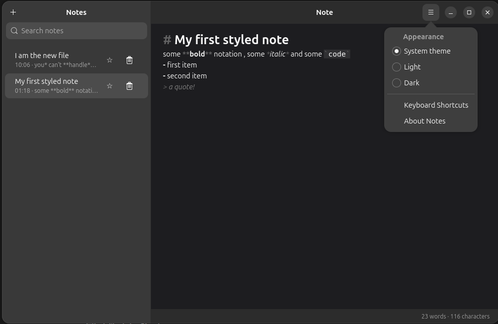

# Notes

A modern, minimal note-taking app for the Ubuntu / GNOME desktop, written in
Rust with GTK4 and libadwaita.

Your notes are plain Markdown files in your home folder: no database, no
account, no lock-in.



## Features

- **Live Markdown styling** as you type: headings (`#` to `###`), **bold**,
  *italic*, `inline code`, fenced code blocks, quotes and bullet lists
- **Instant search** across the titles and text of all notes
- **#tags**: write `#work` anywhere in a note; tags appear as clickable chips
  under the search box and filter the list
- **Pinned notes** that stay at the top of the sidebar
- **Auto-save**: notes are saved a moment after you stop typing, and again when
  you close the window; saves are written safely so a crash can't corrupt a note
- **Sidebar previews** showing when a note was last edited and its first line
- **Light, dark or system theme**, remembered between runs
- **Word and character count**
- **Keyboard-friendly** (see the shortcuts below) and a built-in shortcuts window
- Native look and feel with libadwaita, including an adaptive split layout

## Install

There are no prebuilt releases yet, so you build the package yourself. It takes
a few minutes the first time.

### 1. Install the build requirements (Ubuntu 24.04 or newer)

```bash
sudo apt install build-essential pkg-config libgtk-4-dev libadwaita-1-dev
curl --proto '=https' --tlsv1.2 -sSf https://sh.rustup.rs | sh
```

The app needs GTK 4.14+ and libadwaita 1.5+ (both included in Ubuntu 24.04 and
newer) and a recent stable Rust toolchain (edition 2024, so Rust 1.85 or newer).

### 2. Build and install the .deb package

```bash
git clone https://github.com/Zannatul-Naim/notes-app.git notes-app
cd notes-app
./packaging/build-deb.sh
sudo apt install ./target/deb/notes-app_*_amd64.deb
```

Then open **Notes** from the app grid, or run `notes-app` in a terminal.

### Or just run it without installing

```bash
cargo run --release
```

### Uninstall

```bash
sudo apt remove notes-app            # removes the app, keeps your notes
rm -rf ~/.local/share/notes-app      # only if you also want to delete your notes
```

## Using Notes

A note's **title** is its first line (a line with only tags is skipped).
Everything is saved automatically; there is no save button.

### Keyboard shortcuts

| Shortcut          | Action                              |
| ----------------- | ----------------------------------- |
| `Ctrl+N`          | New note                            |
| `Ctrl+D`          | Delete the open note (asks first)   |
| `Ctrl+P`          | Pin / unpin the open note           |
| `Ctrl+F`          | Search notes (`Esc` clears)         |
| `Ctrl+B`          | Bold (wraps or unwraps the selection) |
| `Ctrl+I`          | Italic                              |
| `Ctrl+Z` / `Ctrl+Shift+Z` | Undo / redo                 |
| `Ctrl+?` or `F1`  | Show the shortcuts window           |
| `F11`             | Toggle full screen                  |
| `Ctrl+Q`          | Quit (saves first)                  |

Each note in the sidebar also has a star button to pin it and a trash button to
delete it. Empty notes are deleted without a confirmation.

### Tags

Type `#` followed by a word, such as `#work` or `#to-do`. A tag must start with
a letter, may contain letters, digits, `_` and `-`, and is case-insensitive.
`# Heading` (with a space) is a heading, not a tag, and tags inside code blocks
are ignored. Click a chip to show only notes with that tag; click it again to
clear the filter. Tag filtering and search can be combined.

## Where your data lives

Everything is stored under `~/.local/share/notes-app/`:

| Path                | Contents                                      |
| ------------------- | --------------------------------------------- |
| `notes/<id>.md`     | One Markdown file per note                    |
| `pinned.txt`        | The ids of pinned notes, one per line         |
| `theme.txt`         | `system`, `light` or `dark`                   |

To back up your notes, copy that folder. Because the notes are ordinary
Markdown files, you can also open them with any other editor.

To try the app without touching your real notes, point it at a throwaway folder:

```bash
XDG_DATA_HOME=/tmp/notes-test cargo run --release
```

## Development

```
Cargo.toml            dependencies (gtk4, libadwaita) and release profile
src/main.rs           the whole application, plus its unit tests
packaging/            icon, .desktop launcher, man page, copyright, build-deb.sh
```

`src/main.rs` is organised in labelled sections: data model, storage helpers,
tags, Markdown styling, UI helpers, `build_ui` and tests. The notes live in a
shared `State`; the sidebar rows are kept in the same order as `state.notes`, and
the editor is a single `TextBuffer` whose `changed` signal drives styling, saving,
re-ordering and the counters.

Useful commands:

```bash
cargo run                       # debug build
cargo test                      # unit tests (tags, titles, previews, counters, safe writes)
cargo build --release           # optimised binary in target/release/
./packaging/build-deb.sh        # build the .deb in target/deb/
```

To release a new version, change `version` in `Cargo.toml` and rebuild; the
package version, changelog and About dialog follow that number. Set your name
and email in `packaging/build-deb.sh` and `packaging/copyright`.

The application id is `com.example.Notes`, a placeholder. If you publish the
app, rename it (the `APP_ID` constant in `src/main.rs`, the `.desktop` file, the
icon file name and `packaging/build-deb.sh`).

## Known limitations

- Markdown styling covers headings, bold, italic, code, quotes and bullet lists.
  Numbered lists, links, images and tables are shown as plain text.
- Styling is recalculated for the whole note on every keystroke. This is instant
  for normal notes (about 20 ms at 1,000 lines) but becomes noticeable for
  extremely large ones (about 0.4 s at 20,000 lines).
- If the app is force-killed (not closed normally), the last half-second of
  typing can be lost.
- A note file that is not valid UTF-8 is skipped, never modified or deleted.
- There is no sync between machines. The package is built for the architecture
  of the machine that builds it.

## Ideas for the future

- Export or back up all notes as a zip file
- Flatpak package
- Images, links and numbered lists in notes
- Syncing notes between machines

## License

MIT. See the `LICENSE` file.
